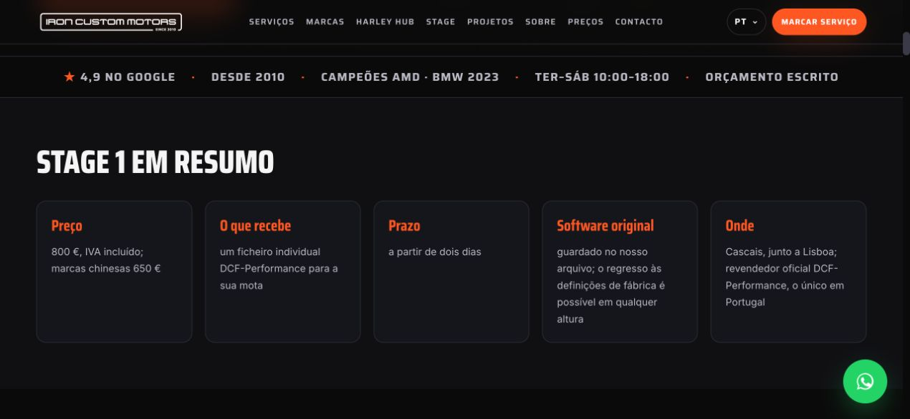
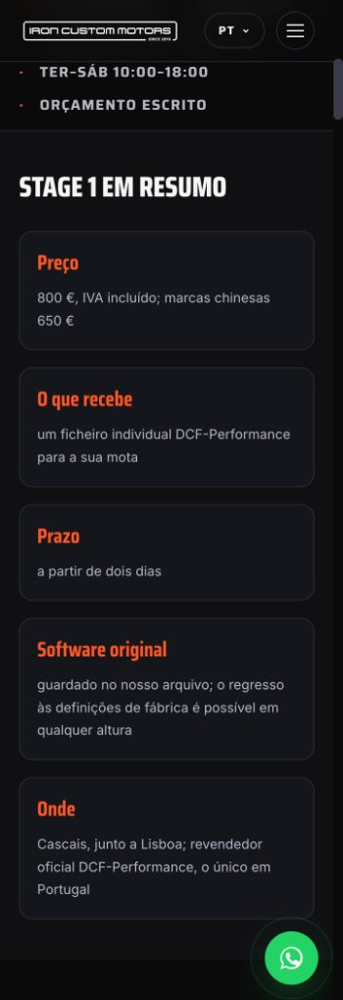
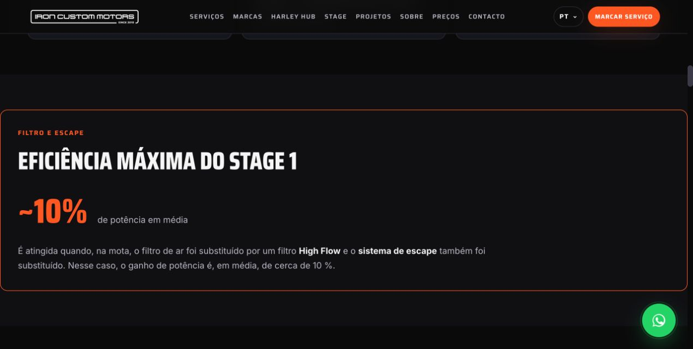

# S-STAGE1-FIX delivery record

Date: 2026-11-11. Status: local acceptance passed; not yet deployed.
Baseline: `abd63a24ba009929cd838a33dafd382f691626a6`, clean `main`; upstream
confirmed identical before editing.

## Scope and decisions

- **Confirmed:** the two approved revisions differ only in the named headings,
  the new Stage Schema name fields and their source-header notes. Both hashes
  match the owner brief; exact inputs replace the tracked source files.
- **Confirmed correction:** the S-STAGE1 registry order accidentally selected
  Stage as the business summary. The summary now selects the homepage by path.
- **Decision E:** retain the complete current related-description registry in
  each brand page's four-language inline payload (22 keys per language), so
  unused entries cannot carry older claims. Visible brand content is protected.
  This supersedes the previous preservation of obsolete related values.
- **Decision B:** split only the specified catalogue separators into layout;
  preserve all words, footnote punctuation, internal label punctuation and prices.
- **Confirmed F7 scope limit:** the homepage has no commercial trust strip.
  Do not introduce one; inspect its existing review widget and verify the
  corrected strip on Stage/brand pages and throughout its 60-page inventory.
- **Owner-requested F9 exception:** sitemap entries retain their baseline dates;
  this correction changes only their order. No general date algorithm changes.

## Verification

- New summary and related-description checks reject the baseline output.
- Full documented rebuild and `verify_site.sh` passed locally, including all
  family validators and Worker tests. New checks reject missing/wrong homepage
  summary, non-homepage sitemap start, stale related descriptions, editorial
  headings, old DCF phrases and incorrect localized Service names.
- [Scope evidence](stage1-fix/scope.json): 217 HTML files are byte-identical;
  28 change only the trust wrapper, 28 brand pages change only that wrapper and
  inline related data, four dealer pages change only the approved heading,
  and four Stage pages change only B/C and trust spacing. Other Stage JSON-LD
  is identical; other brand inline keys are identical. Shared assets, all PDFs
  and Stage media are byte-identical. Sitemap entries are identical and reordered;
  llms differs only in its summary and Stage entry position.
- [Browser evidence](stage1-fix/browser-checks.json): all four languages at
  360/375/390/414/430 (height 812) and 768/1280 (height 900), 28 cases.
  No horizontal overflow, no 650 EUR/WhatsApp overlap, and the amount is on the
  first screen in every case (maximum bottom 803.54 px on phones). The figure
  uses 38–64 px with a 16 px caption; opening paragraphs have 15–16 px spacing.
  B5 preserves the note's type size, reduces only its leading/top margin and
  reserves horizontal space after the nonbreaking currency amount.
- [Trust evidence](stage1-fix/trust-checks.json): Stage and BMW in four languages
  show a real normal space of 3.67–5.25 CSS px. All 60 strips share the corrected
  markup. The four home pages retain their existing rating/count and have no
  trust strip, as before.
- Exact approved copy-unit parity passes with only the explicitly requested
  layout separators removed. The four localized Service names match rev. 2;
  FAQ, Offers, provider, ImageObject and breadcrumbs are preserved.
- Clean-clone reproduction, commit identifiers and production checks pending.

## Requested screenshots

Native browser captures, Portuguese, viewport widths 1280 and 360 CSS px;
height adjusted to show each complete block with page context. No image editing.

| Block | 1280 px | 360 px |
|---|---|---|
| Facts |  |  |
| Maximum efficiency |  |  |
| Price box |  |  |

## Changed source files

- `assets/stage.css`
- `scripts/build/README.md`
- `scripts/build/authorized_dealer_data.py`
- `scripts/build/build_brand_pages.py`
- `scripts/build/build_llms.py`
- `scripts/build/build_sitemap.py`
- `scripts/build/build_stage_pages.py`
- `scripts/build/content/dcf_dealer_copy_4lang.md`
- `scripts/build/content/stage1_copy_4lang.md`
- `scripts/build/stage_copy.py`
- `scripts/build/stage_pages_data.py`
- `scripts/build/trust_strip.py`
- `scripts/build/validate_seo.py`
- `scripts/build/validate_service_custom_hubs.py`
- `scripts/build/validate_stage_pages.py`
